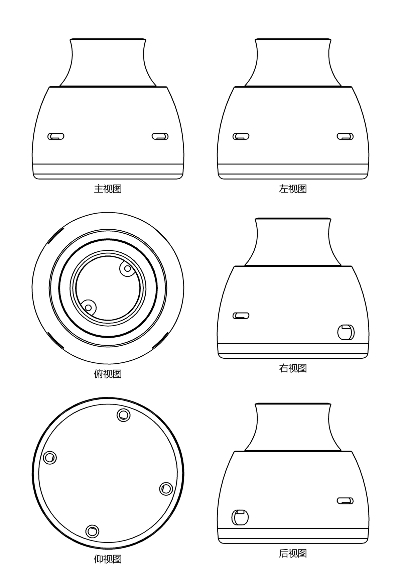
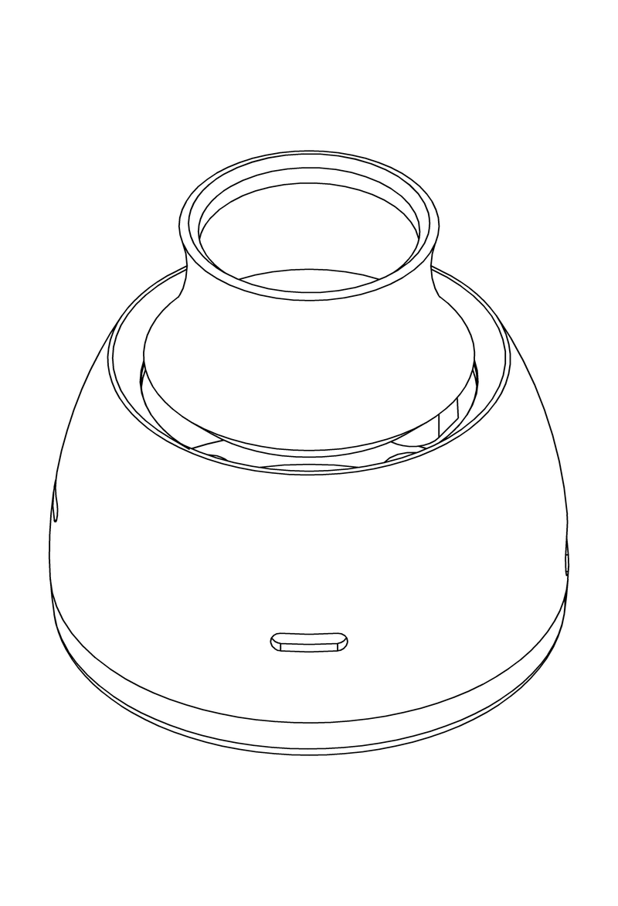

# 外观设计专利视图生成工具

把 STEP 三维模型转成**可直接提交中国专利局**的外观设计六视图 + 立体图 + 可编辑 DXF。

**全程本地运行，模型不上传。** 一句对话完成，不用打开任何 CAD 软件。



---

## 它解决什么问题

中国外观设计专利申请要求提交六面视图 + 立体图，且有一堆硬性规定：
只用均匀实线、禁止虚线/中心线/尺寸线、图内不能有任何文字、像素必须落在指定区间……

手工在 CAD 里出这套图，步骤繁琐，还容易踩合规坑。

本工具从 STEP 模型直接生成：

| 产出 | 说明 |
|---|---|
| `submission/1-主视图.jpg` … `7-立体图.jpg` | **7 张提交件**，中文命名、按视图顺序编号，150×220mm @300DPI，可直接上传专利局 |
| `all_views.dxf` | 全部视图合一的**可编辑矢量**，1:1 mm |
| `sheet_grid.png` | 六视图图幅，便于预览 |
| 合规自检报告 | **33 项**自动检查，标出不合格项 |

---

## 核心特点

- **精确几何投影** —— 用 OpenCascade 的 HLR 隐藏线消除（与 FreeCAD TechDraw 同款算法），不是 AI 猜图
- **合规规格固化** —— DPI、像素区间、线宽、视图命名全部按 CNIPA 要求写死
- **33 项自动自检** —— 格式/线条/视图/清晰度/文书五类，出图后自动核查
- **本地运行** —— 模型不离开你的电脑，适合未公开的外观设计
- **可编辑 DXF** —— 导出的是原生 `ARC`/`CIRCLE`/`LINE`，不是一堆折线

---

## 能在哪些 AI 上使用

本工具**在你自己的电脑上运行**，所以必须搭配**能执行本地命令的 AI agent**。

| AI 使用方式 | 能否使用 | 说明 |
|---|---|---|
| **本地 CLI agent**<br>Claude Code、Cursor、DSH、Cherry Studio、Cline 等 | ✅ **可以** | 有命令行权限，可直接调用 |
| **本地客户端 + MCP**<br>Claude Desktop 等 | ⏳ 暂未支持 | 需要 MCP server，可后续补充 |
| **网页版 AI**<br>ChatGPT、Kimi、豆包、DeepSeek 网页版、文心一言等 | ❌ **不能** | 网页版看不到你的磁盘，也无法在你电脑上运行程序 |

### 为什么网页版不行

外观视图需要**精确的几何计算**（OpenCascade 隐藏线消除），依赖：

- 约 91MB 的运行环境（OCP 几何内核）
- 本地读取 STEP 文件
- 在你电脑上做计算

网页版 AI 跑在云端，**既访问不到你的文件，也无法在你电脑上执行程序**。

> ⚠️ 我们也**不提供**"上传模型到云端处理"的方式——
> 未公开的外观设计一旦上传，可能构成公开，影响新颖性。
> 这是本工具坚持本地运行的根本原因。

### 如果你只有网页版 AI

可以在本地用命令行出图，再把结果贴给网页版 AI 讨论：

```bash
patent-cli auto --step 你的模型.step --front +Y --up +Z
```

出图后打开 `output/<产品名>/submission/` 里的 7 张 JPEG，或 `sheet_grid.png` 六视图图幅。

---

## 安装

本工具以 **Skill** 形式提供给 AI agent 使用，安装分两步：**先装技能，再装运行环境**。

### 第一步 · 装技能

让 agent 能读到本项目的 `SKILL.md`。任选其一：

| 方式 | 做法 |
|---|---|
| **技能平台** | 在 DSH Market / ClawHub / SkillHub 搜索「外观设计专利视图」安装 |
| **手动** | 把仓库放进 agent 的技能目录：`git clone https://github.com/felix-lius/design-patent-views` |

装好后，agent 就能识别「把这个 STEP 出成外观专利视图」这类请求。

### 第二步 · 装运行环境

技能文件就位后，还需要装运行环境。两种方式，都只需要**复制一段话给你的 AI agent**，其余全自动。

#### 方式 A · 一键包（推荐）

不需要 Python，下载解压即用。

```
帮我装一下外观设计专利视图生成工具的一键包：https://github.com/felix-lius/design-patent-views/releases/download/v0.1.0/design-patent-views-win64.zip

自包含整合包，解压即用，不需要装 Python。装好跑个冒烟测试进行确认。
```

#### 方式 B · 自己装依赖（需要 Python 3.12）

```
帮我装一下外观设计专利视图生成工具的依赖。

需要：Python 3.12 + cadquery-ocp==7.7.2、Pillow、ezdxf、numpy
基于技能目录里的 install_deps.py，运行它自动检测并只安装缺少的。
装完用 --check 复验，全部 ✓ 才算成功。
```

> 依赖已装过的不会重装——脚本会先逐项检测，只补缺的。
> 详细的安装步骤和故障排查见 [`INSTALL.md`](INSTALL.md)。

---

## 使用

装好后，直接对 agent 说：

```
用外观设计专利视图生成工具，把 <你的模型.step> 出成外观专利的六视图 + 立体图
```

> **输入格式要求：仅支持 STEP（`.step` / `.stp`）**
>
> 外观视图需要精确的隐藏线消除，依赖完整的 B-Rep 实体拓扑。
> STEP 是唯一能稳定携带实体拓扑的通用交换格式。
>
> | 格式 | 是否支持 | 原因 |
> |---|---|---|
> | `.step` / `.stp` | ✅ | 完整实体拓扑 |
> | `.iges` / `.igs` | ❌ | 常丢实体，只剩曲面 |
> | `.stl` / `.obj` / `.3mf` | ❌ | 三角网格，无 B-Rep 拓扑 |
> | `.sldprt` / `.prt` / `.catpart` | ❌ | 原生格式无法读取 |
>
> 请在 CAD 中「另存为 / 导出」为 STEP（AP203 或 AP214）后使用。

流程会自动走：

```
analyze  分析模型（实体数、尺寸、有效性）
   ↓
need=orientation (stage=main_view)  → 6 张缩略图，问哪张作为主视图
   ↓
need=orientation (stage=up_axis)    → 4 张候选，问哪张是产品的上方
   ↓
need=solid_selection                → 多实体时问保留哪些外观件
   ↓
出图 + 导 DXF + 33 项合规自检
```

**最多问三个问题（主视图、上方向、外观件），10 秒出图。**

> 为什么上方向也要确认：它决定俯视图和仰视图哪个在上、哪个在下，
> 弄反会导致附图形式缺陷。

### 存到哪个文件夹

默认导出到程序所在目录。想换个地方，说一句就行：

```
以后都导出到 D:\专利出图
```

工具会记住，以后每次出图都放那里，不用重复交代。想改就再说一次；想恢复默认：

```bash
patent-cli config --reset
```



---

## 直接命令行使用

```bash
# 一步到位
patent-cli auto --step model.step

# 已确认方位
patent-cli auto --step model.step --front +Y --up +Z

# 分步
patent-cli analyze --step model.step --quiet
patent-cli render  --step model.step --front +Y --up +Z --quiet
patent-cli dxf     --step model.step --front +Y --up +Z --quiet
patent-cli check   --step model.step --quiet

# 导出目录：设置一次，以后都记住
patent-cli config --out-dir "D:/专利出图"
patent-cli config                      # 看当前导出到哪
patent-cli config --reset              # 恢复默认

# 只这一次换目录（不改记忆）
patent-cli auto --step model.step --out-dir "D:/临时"
```

退出码：`0` 成功 / `2` 需要你输入 / `3` 输入错误 / `4` 引擎错误

---

## 合规规格

本工具按 CNIPA 要求固化以下参数：

| 项 | 要求 | 本工具 |
|---|---|---|
| 文件格式 | 仅 JPEG | ✅ |
| 分辨率 | 72–300 DPI | 300 DPI |
| 像素 | 467.7×694.4 ～ 1948.8×2893.7 | 1772×2598 |
| 版面 | ≤ 150×220 mm | 150×220 mm |
| 产品图形 | ≥ 3cm×8cm | 自动校验 |
| 线条 | 只允许均匀实线 | ✅ |
| 图内文字 | 禁止 | ✅ 无文字 |
| 单案大小 | ≤ 30MB | 约 0.5–1.4MB |

完整规格见 [`中国外观设计专利制图合规规格.md`](中国外观设计专利制图合规规格.md)。

---

## 已知限制

| 限制 | 说明 |
|---|---|
| **不支持网页版 AI** | 需要本地执行环境，网页版（ChatGPT/Kimi/豆包等）无法使用，详见上方「能在哪些 AI 上使用」 |
| **仅 Windows x64** | 一键包只打了 Windows；轻量版理论跨平台但未验证 |
| **输入几何必须有效** | 含破面/自交的模型会导致 HLR 丢线，工具会告警但无法修复，需在 CAD 中处理 |
| **装配体需人工筛外观件** | 内部结构（PCB、螺丝）画进附图不合格，工具会提示但不替用户判断 |
| **方位需人工确认** | CAD 坐标轴常与产品实际朝向不一致，不能自动推断 |
| **大装配体较慢** | 183 实体的模型约需 81 秒 |

详见 [`DEVELOPMENT.md`](DEVELOPMENT.md) 第 13 章。

---

## 验证情况

已用 **9 个真实产品模型**验证，覆盖 6 个品类：

| 品类 | 模型 | 实体数 | 结果 |
|---|---|---|---|
| 移动电源 | powerbank | 1 | 25 通过 / 0 警告 / 0 失败 |
| 蓝牙音箱 | speaker_l | 3 | 23 / 2 / 0 |
| 游戏手柄 | gamepad_joystick | 2 | 24 / 1 / 0 |
| 3D 鼠标 | spacemouse | 13 | 24 / 1 / 0 |
| 3D 鼠标外壳 | spacemouse_shell | 3 | 25 / 0 / 0 |
| 完整鼠标 | mouse_moudabella | 183 | 21 / 4 / 0 |
| 鼠标外壳 | mouse_shell | 7 | 22 / 3 / 0 |
| 薄壁壳体 | thinwall_case | 12 | 24 / 1 / 0 |
| 参数件 | sample_product | 1 | 24 / 1 / 0 |

生成的 JPEG 已实测上传至**国家知识产权局专利业务办理系统**（外观设计申请图片栏），系统可直接识别、无格式报错。

---

## 许可证

**MIT + Commons Clause** —— 自己用、改、内部部署都可以（含商业业务），但**不能把本工具本身拿去卖**。

详见 [`LICENSE`](LICENSE)。

---

## 相关文档

| 文档 | 内容 |
|---|---|
| [`INSTALL.md`](INSTALL.md) | 详细安装步骤、故障排查（给 agent 读） |
| [`SKILL.md`](SKILL.md) | AI agent 使用指令 |
| [`DEVELOPMENT.md`](DEVELOPMENT.md) | 技术实现、设计决策、能力边界 |
| [`中国外观设计专利制图合规规格.md`](中国外观设计专利制图合规规格.md) | CNIPA 合规规格 v1.0 |
| [`六视图生成流程图.svg`](六视图生成流程图.svg) | 整体流程图 |
